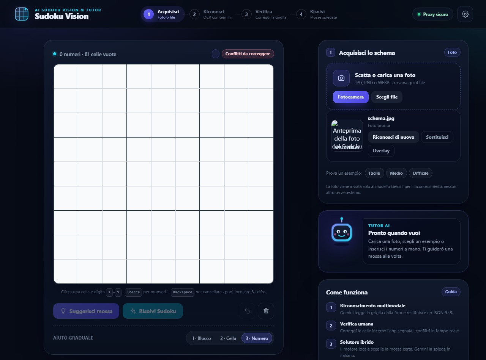

# AI Sudoku Vision & Tutor

Web app multimodale che fotografa un Sudoku cartaceo, lo digitalizza con **Google Gemini**,
permette di correggere la griglia e poi assiste l'utente con **suggerimenti spiegati in italiano**
oppure con la **soluzione completa**.

Progetto didattico di Informatica / Laboratorio di Tecnologie Web.
Nessuna API key è presente nel codice: la chiave vive solo nel file `.env` (ignorato da Git)
oppure, in modalità demo, nel `localStorage` del browser.



---

## Funzionalità

### Requisiti base

| Requisito | Come è stato realizzato |
| --- | --- |
| Acquisizione foto o file | Fotocamera (`getUserMedia`) con guida di inquadratura, drag & drop, selettore file, incolla dagli appunti |
| OCR con Gemini | Prompt multimodale + **Structured Output** JSON Schema → matrice 9×9, angoli della griglia, celle incerte |
| Griglia editabile | 81 celle HTML, navigazione da tastiera, incolla di 81 cifre, controllo conflitti in tempo reale |
| Suggerisci mossa | Motore locale che sceglie la mossa più semplice + spiegazione Gemini (o locale) |
| Risolvi Sudoku | Backtracking MRV locale, animazione cella per cella, celle AI evidenziate in viola |
| `.env.example` | Presente, con istruzioni e nessun segreto |
| Relazione tecnica | [`RELAZIONE_TECNICA.md`](RELAZIONE_TECNICA.md) (max 2 pagine) |

### Bonus implementati

- **Tutor vocale** — Web Speech API con voce italiana, velocità calibrata e pulsante “Ascolta”.
- **Avatar interattivo** — SVG animato con espressioni `idle`, `thinking`, `happy`, `alert`, `celebrate`, sincronizzate con lo stato del gioco.
- **Hint progressivi a 3 livelli** — 1) evidenzia il blocco, 2) indica la cella e i candidati, 3) rivela il numero con spiegazione.
- **Solutore ibrido** — il motore locale garantisce che la mossa sia corretta al 100%; Gemini scrive la spiegazione.
- **Overlay fotografico AR-lite** — i numeri risolti vengono proiettati sulla foto originale con un'**omografia** (Canvas 2D) e angoli trascinabili.
- **Modalità “Solo Gemini”** — il modello propone la mossa, che viene comunque validata dal solutore locale prima di essere mostrata.
- **Persistenza** — impostazioni e ultima griglia restano in `localStorage`; undo multiplo e pulsante di svuotamento.

---

## Avvio rapido

Requisiti: **Python 3.9+** (solo libreria standard). Non serve Node.js, npm o un bundler.

```bash
# 1. Configura la chiave (una sola volta)
copy .env.example .env          # Windows
cp .env.example .env            # macOS / Linux

# 2. Apri .env e incolla la chiave da https://aistudio.google.com/apikey
#    GEMINI_API_KEY=AIza...

# 3. Avvia il server locale
py -3 server.py                 # Windows
python3 server.py               # macOS / Linux
```

Il browser si apre su <http://localhost:8765>. Su Windows è disponibile anche
`avvia.bat` (doppio clic). Per usare lo smartphone sulla stessa rete:

```bash
py -3 server.py --host 0.0.0.0
```

> **Perché un server?** L'app usa ES Modules: da `file://` il browser li blocca.
> Il server serve i file statici e fa da proxy verso Gemini, così la chiave non
> raggiunge mai il browser. In alternativa `py -m http.server` funziona per la UI,
> ma senza proxy dovrai inserire la chiave nelle impostazioni (modalità demo).

### Deploy pubblico su Vercel

Vercel serve i file statici e trasforma `api/*.py` in serverless functions:

1. Fai il commit e il push di tutti i file **tranne `.env`** (già ignorato da Git).
2. In Vercel: **Settings → General → Root Directory** = cartella che contiene
   `index.html` (es. `Sudoku-AI`); **Framework Preset** = `Other`;
   **Build Command** vuota; **Output Directory** = `.`.
3. **Settings → Environment Variables**: aggiungi `GEMINI_API_KEY` con la chiave,
   selezionando **Production**. Aggiungi eventualmente `GEMINI_MODEL` e
   `GEMINI_FALLBACK_MODELS` (vedi `.env.example`).
4. **Deployments → Redeploy**.
5. Verifica `https://<progetto>.vercel.app/api/health`: deve rispondere
   `"configured": true`. Solo allora OCR e tutor funzioneranno.

La chiave resta lato server: non inserirla mai nelle impostazioni del browser
per un link pubblico.

### Pagina di test

Con il server attivo apri <http://localhost:8765/tests.html>:
13 test automatici verificano solutore, unicità delle soluzioni, suggerimenti
progressivi, validazione dei conflitti e matematica dell'overlay.

---

## Struttura del progetto

```
Sudoku-AI/
├── index.html                  # UI completa (griglia, tutor, dialog)
├── tests.html                  # runner dei test nel browser
├── server.py                   # server statico + proxy Gemini (.env)
├── api/
│   ├── gemini.py               # proxy Gemini come Vercel Function
│   └── health.py               # /api/health per il deploy Vercel
├── vercel.json                 # config deploy (nessun build, framework "Other")
├── pyproject.toml              # runtime Python 3.12, zero dipendenze
├── avvia.bat                   # launcher Windows
├── .env.example                # modello di configurazione (nessun segreto)
├── .gitignore                  # esclude .env, cache, ecc.
├── README.md
├── RELAZIONE_TECNICA.md
├── docs/
│   └── app-screenshot.jpg
└── assets/
    ├── css/styles.css          # tema scuro responsive, animazioni, celle
    ├── img/favicon.svg
    └── js/
        ├── app.js              # controller: flusso, eventi, stato, undo
        ├── sudoku.js           # validazione, candidati, backtracking MRV, hint
        ├── gemini.js           # client REST, structured output, errori
        ├── camera.js           # fotocamera + ridimensionamento immagini
        ├── overlay.js          # omografia e disegno prospettico su Canvas
        ├── speech.js           # sintesi vocale italiana
        ├── samples.js          # tre griglie di esempio verificate
        └── tests.js            # test del motore e dell'overlay
```

---

## Architettura

```
┌──────────────────────────── Browser ────────────────────────────┐
│  index.html + app.js                                            │
│                                                                 │
│  Foto ──► camera.js ──► gemini.js ──► JSON 9×9 ──► griglia      │
│                              │                        │         │
│                              │                 sudoku.js        │
│                              │           validazione / hint     │
│                              ▼                        ▼         │
│                    spiegazione italiana      overlay.js (canvas)│
│                              │                        │         │
│                        speech.js                 avatar SVG     │
└──────────────────────────────┼──────────────────────────────────┘
                               │ POST /api/gemini
                     ┌─────────▼──────────┐
                     │     server.py      │
                     │  legge .env        │
                     │  valida modello    │
                     └─────────┬──────────┘
                               │ HTTPS + x-goog-api-key
                     ┌─────────▼──────────┐
                     │  Gemini API        │
                     │ gemini-3.5-flash-  │
                     │ lite (+ fallback)  │
                     └────────────────────┘
```

### Perché un solutore ibrido

Un LLM può sbagliare una deduzione logica. Per garantire correttezza didattica:

1. `sudoku.js` trova la prossima mossa con tecniche deterministiche
   (singolo nudo → singolo nascosto → fallback verificato dal solutore).
2. La mossa e la spiegazione locale compaiono **subito**; in modalità ibrida la
   richiesta a Gemini parte in background e, quando arriva, sostituisce il testo
   con la spiegazione del tutor (badge “Spiegazione Gemini”). Se Gemini è lento o
   sovraccarico l'utente non resta mai bloccato.
3. Gemini riceve griglia, mossa, tecnica e candidati e produce **solo** la spiegazione.
4. In modalità “Solo Gemini” la mossa proposta viene comunque controllata con
   `isLegalMove()` contro la soluzione calcolata localmente; se non è valida,
   l'app usa la mossa locale e avvisa l'utente.

### OCR e JSON Schema

La richiesta di riconoscimento usa `responseMimeType: "application/json"` e uno
schema con tipi in maiuscolo (`OBJECT`, `ARRAY`, `INTEGER`, `NUMBER`), come richiesto
dall'API REST. Oltre alla matrice, il modello restituisce:

- `corners` — i 4 angoli esterni in coordinate normalizzate (per l'overlay);
- `uncertain` — le celle di cui non è sicuro (evidenziate in ambra);
- `notes` — una nota sulla qualità della foto.

Tutte le risposte vengono normalizzate e validate prima di toccare la griglia.

### Gestione degli errori

- Messaggi in italiano per chiave assente/non valida, modello inesistente,
  quota esaurita (429), timeout, rete assente, risposta bloccata o JSON malformato.
- Timeout con `AbortController`, retry manuale, fallback alla spiegazione locale
  mostrata subito mentre la richiesta AI resta in background.
- Il proxy limita dimensione del corpo (16 MB), valida il nome del modello,
  inoltra solo i campi previsti e non registra mai la chiave nei log.
- Le richieste a `.env`, `.git` e alle altre risorse nascoste restituiscono 404.

---

## Configurazione

| Variabile | Default | Descrizione |
| --- | --- | --- |
| `GEMINI_API_KEY` | — | Chiave da Google AI Studio (obbligatoria per OCR e tutor AI) |
| `GEMINI_MODEL` | `gemini-3.5-flash-lite` | Modello usato dal proxy |
| `GEMINI_FALLBACK_MODELS` | lista predefinita | Modelli provati in ordine se il precedente è ritirato (404) o sovraccarico (503) |
| `PORT` | `8765` | Porta del server locale |
| `HOST` | `127.0.0.1` | Indirizzo di ascolto: `0.0.0.0` rende l'app raggiungibile dalla LAN |

Modelli selezionabili dall'interfaccia: `gemini-3.5-flash-lite`, `gemini-3-flash-preview`,
`gemini-3.6-flash`, `gemini-3.8-flash`, `gemini-flash-latest`.
Google ritira periodicamente i modelli (per esempio `gemini-2.5-flash` risponde ormai 404):
il proxy prova in automatico `GEMINI_MODEL` e poi la catena `GEMINI_FALLBACK_MODELS`,
inoltra la risposta del primo modello disponibile e comunica quello usato con l'header
`X-Gemini-Model`. Se il modello scelto è stato **ritirato** (404) l'app salva quello nuovo;
se invece è solo un **picco di sovraccarico** (503) il ripiego vale per la singola richiesta
e la preferenza dell'utente resta invariata. Ogni modello viene provato una volta sola
(ritentare subito lo stesso modello può costare decine di secondi); alla fine della catena
il modello predefinito viene ritentato un'ultima volta.

### Modalità senza `.env` (demo)

Apri l'app con un server statico qualsiasi, apri **Impostazioni** e incolla la chiave:
viene salvata nel `localStorage` e le chiamate partono direttamente dal browser.
È comodo per una demo, ma **non** va usato per un sito pubblico: chiunque può leggere
la chiave dal browser. Per la consegna usa sempre il proxy Python.

---

## Come si usa

1. **Acquisisci** — “Fotocamera”, “Scegli file”, trascina un'immagine o incolla con `Ctrl+V`.
2. **Riconosci** — Gemini restituisce la matrice; le celle incerte sono in ambra.
3. **Verifica** — digita `1`–`9`, usa le frecce, `Backspace` per cancellare; i conflitti
   sono evidenziati in rosso e bloccano suggerimento/soluzione finché non li correggi.
4. **Risolvi** — “Suggerisci mossa” (con livello di aiuto 1–3) oppure “Risolvi Sudoku”.
   I numeri aggiunti dall'AI sono in viola; “Undo” annulla anche una risoluzione completa.
5. **Overlay** — apri la miniatura della foto e regola i quattro angoli per proiettare
   i numeri sulla foto originale.

Scorciatoie: `1`–`9` inseriscono, `0`/`Backspace`/`Delete` cancellano, le frecce
spostano il cursore; incollando 81 cifre la griglia viene compilata in un colpo.

---

## Test

```bash
py -3 server.py
# poi apri http://localhost:8765/tests.html
```

Copertura attuale: **13/13 test superati** — unicità e soluzione dei tre esempi,
conflitti, griglie impossibili, completamento guidato passo-passo, candidati,
legalità delle mosse e omografia dell'overlay.

---

## Privacy e sicurezza

- La foto viene inviata **solo** a Gemini per l'OCR; non esistono altri backend.
- La chiave non è mai nel repository: `.env` è in `.gitignore`; `.env.example` contiene
  un segnaposto.
- Il server locale ascolta su `127.0.0.1` per default e blocca i file nascosti.
- Nessun dato viene inviato a servizi di analytics.

## Possibili estensioni

Rilevamento automatico dei bordi con OpenCV/WebAssembly, salvataggio di più partite,
difficoltà stimata dai tempi di risoluzione, PWA offline con service worker,
confronto tra più modelli Gemini in parallelo.

---

Progetto didattico — **AI Sudoku Vision & Tutor** · HTML/CSS/JS + Python stdlib + Gemini API.
