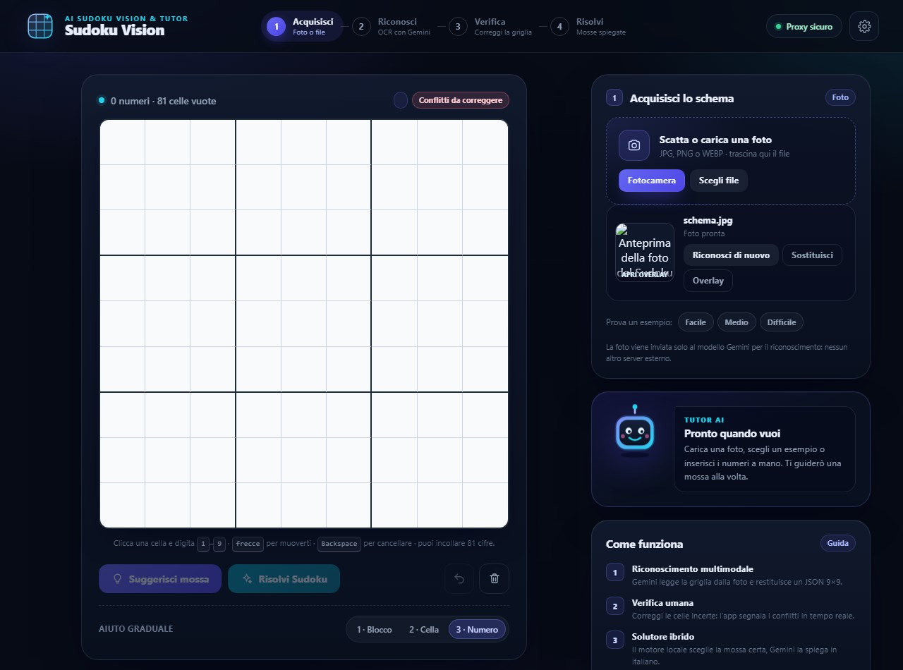

# AI Sudoku Vision & Tutor — Relazione tecnica

**Progetto:** Web application multimodale con Google Gemini API
**Materia:** Informatica / Laboratorio di Tecnologie Web
**Autore/i:** Davide Finocchiaro· **Classe:** 5F INF · **A.S.** 2026/2027



---

## 1. Idea e flusso d'uso

L'app digitalizza un Sudoku cartaceo e assiste l'utente nella risoluzione, seguendo i
quattro passaggi richiesti: **acquisizione** (fotocamera, file, drag & drop o appunti),
**riconoscimento** con Gemini, **verifica manuale** su griglia HTML e **assistenza**
con “Suggerisci mossa” oppure “Risolvi Sudoku”. L'interfaccia è in italiano, responsive
e utilizzabile da tastiera; tre esempi permettono di provare l'app senza foto o chiave.

## 2. Architettura

Nessun build step: HTML, CSS e JavaScript ES Modules, serviti da un backend Python
basato solo sulla libreria standard.

```text
Browser
  index.html / app.js
    ├── camera.js  → acquisizione e ridimensionamento (max 1600 px)
    ├── gemini.js  → client REST + JSON Schema + gestione errori
    ├── sudoku.js  → validazione, candidati, backtracking MRV, hint
    ├── overlay.js → omografia e disegno prospettico su Canvas
    └── speech.js  → sintesi vocale italiana (Web Speech API)
        │  POST /api/gemini
        ▼
  server.py  ── legge .env, valida modello e payload, inoltra la richiesta
        │  HTTPS + x-goog-api-key
        ▼
  Google Gemini API
```

`server.py` serve i file statici, espone `/api/health` e fa da proxy: **la chiave API
non raggiunge mai il browser**. Il file `.env` è escluso da Git, le richieste a `.env`,
`.git` e alle risorse nascoste restituiscono 404, il corpo è limitato a 16 MB e sono
accettati solo modelli `gemini-*`. Poiché Google ritira periodicamente i modelli, il
proxy prova in ordine `GEMINI_MODEL` e la catena `GEMINI_FALLBACK_MODELS`, inoltra la
prima risposta valida e comunica il modello usato con l'header `X-Gemini-Model`. L'app
salva il nuovo modello solo se quello scelto è stato ritirato (404), mentre un ripiego
dovuto a un picco di sovraccarico (503) resta temporaneo. Senza proxy l'app funziona in
**modalità demo** con la chiave nel `localStorage` (solo per uso locale, mai per un sito
pubblico).

## 3. Scelte tecniche

**OCR strutturato.** L'immagine è inviata come `inlineData` con un prompt che chiede di
leggere solo i numeri dello schema, ignorando appunti e candidati. La risposta usa
`responseMimeType: application/json` e un JSON Schema con tipi in maiuscolo. Oltre a
`grid` (9×9, 0 = vuota), il modello restituisce `corners` (angoli normalizzati per
l'overlay), `uncertain` (celle dubbie, evidenziate in ambra) e `notes`. Ogni risposta è
normalizzata: una matrice non 9×9 o priva di numeri genera un errore gestito.

**Solutore ibrido.** Un LLM non è affidabile al 100% sulle deduzioni logiche. Il motore
locale implementa candidati, singolo nudo, singolo nascosto e un fallback verificato con
backtracking + MRV. Gemini riceve la mossa già scelta e la tecnica usata e produce
**solo** la spiegazione in italiano, citando riga, colonna e blocco. Il suggerimento
locale appare subito; la spiegazione Gemini arriva in background e aggiorna il pannello
quando è pronta, così una risposta lenta non blocca l'interfaccia. In modalità “Solo
Gemini” la mossa proposta è comunque controllata con `isLegalMove()` contro la soluzione
locale: se non è valida, l'app usa la mossa locale e avvisa l'utente.

**Hint progressivi.** Livello 1: evidenzia il blocco 3×3. Livello 2: indica la cella con
i candidati. Livello 3: inserisce il numero e mostra la spiegazione. L'utente può
avanzare con “Mostra la cella” / “Svela il numero”.

**Overlay AR-lite.** I quattro angoli restituiti da Gemini definiscono un'omografia
calcolata risolvendo un sistema lineare 8×8; griglia e numeri sono proiettati sulla foto
con Canvas 2D e gli angoli sono trascinabili. L'opzione “Solo numeri aggiunti” mostra
soltanto le cifre calcolate dall'AI.

**Voce e avatar.** La Web Speech API legge la spiegazione con voce italiana, se
disponibile. L'avatar SVG cambia espressione (`thinking`, `happy`, `alert`, `celebrate`)
in base allo stato. Entrambi si attivano dalle impostazioni e rispettano
`prefers-reduced-motion`.

**Errori e usabilità.** Timeout con `AbortController` e messaggi italiani per chiave
assente o non valida, modello inesistente, quota esaurita (429), rete assente, risposta
bloccata o JSON malformato. Sono inclusi undo multiplo, autosalvataggio, svuotamento,
toast non invasivi, navigazione da tastiera e incolla di 81 cifre.

## 4. Verifica e risultati

`tests.html` esegue **13 test automatici nel browser**, senza chiamate API: unicità e
soluzione dei tre esempi, conflitti, rifiuto di griglie impossibili, completamento
guidato, candidati, legalità delle mosse e mappatura dei quattro angoli. Esito:
**13/13 superati**. Il collaudo end-to-end ha confermato caricamento esempio (30 indizi),
hint a 3 livelli, soluzione completa (51 celle AI, nessun conflitto), undo, svuotamento
e overlay su foto sintetica 900×900 con regolazione degli angoli.

## 5. Limiti e sviluppi

L'OCR dipende dalla qualità della foto: riflessi e prospettive estreme possono richiedere
correzioni manuali (già supportate). I modelli gratuiti hanno limiti di quota, gestiti con
messaggi chiari. Sviluppi futuri: rilevamento bordi con OpenCV/WebAssembly, PWA offline,
salvataggio di più partite e confronto tra modelli.

## 6. Corrispondenza con i criteri

| Criterio | Elementi del progetto |
| --- | --- |
| Funzionalità base (40%) | Foto/file, OCR, griglia editabile, suggerimento, soluzione completa |
| API e JSON (25%) | Prompt dedicati, JSON Schema, normalizzazione, errori HTTP, proxy sicuro |
| Interfaccia (20%) | Tema scuro responsive, conflitti visivi, tastiera, toast, undo |
| Bonus (15%) | Voce, avatar, 3 livelli di hint, solutore ibrido, overlay, Solo Gemini |

---

*Stack: HTML5, CSS3, JavaScript ES Modules, Canvas 2D, Web Speech API, Python 3 (stdlib),
Gemini API. Nessuna dipendenza esterna, nessuna chiave nel repository.*
